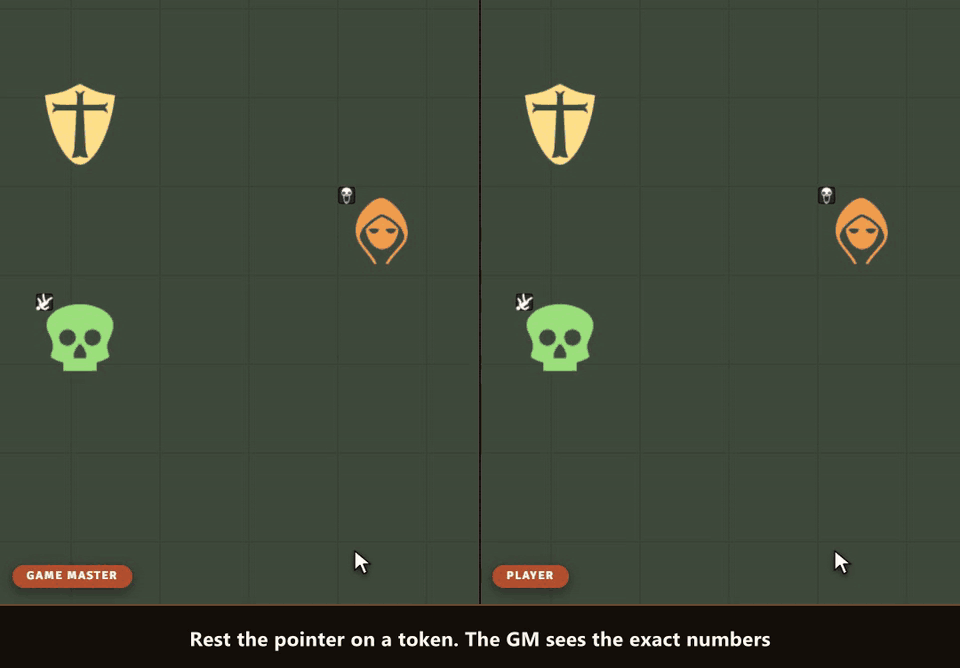

# Sephral’s Token Tooltips

**"How hurt is the goblin?" "What was my armor class again?" Rest the pointer on a token and the answer is right there: health as a bar or a word like bloodied, armor, speed and every condition. You decide what each player gets to see.**

## Highlights

* **One glance, no sheet:** health, armor, speed, conditions and more appear next to the token after a short pause.
* **Words instead of numbers:** players see that the ogre is *bloodied* or *near death* without learning its hit points.
* **You decide who sees what:** every value has its own audience, from GM only to everyone, and its own form for friends, neutrals, foes and secret tokens.
* **A column for the party:** choose how players see each other's heroes, for example how hurt a friend is without the exact hit points. Friendly NPCs keep their own setting.
* **Observers see like owners:** a player who may observe a character sees its tooltip just like its owner.
* **Ready for your system:** presets for D&D 5e, Pathfinder 2e, Savage Worlds and Crucible. Any other system shows the token bars and conditions right away.
* **More when you need it:** values often needed in play, such as passive Insight, the spell save DC or hero points, wait in the list for a tick.
* **Your own values with a click:** pick from the common values of your system or from every value of a token, see its current value and add it.
* **Live preview:** see a token as the GM, as its owner, as another player and as a party member before you save.
* **All tooltips at once:** hold Alt and every visible token shows its tooltip.
* **Safe by design:** hidden tokens stay hidden, and names follow each token's own name display.

## How it works

1. Enable the module. Rest the pointer on a token and its tooltip appears.
2. As GM, open *Configure fields* in the module settings, tick the values you want and choose what players see.
3. Hold Alt during a fight to read the whole battlefield at once.

## Good to know

Players can only ever see what the GM allows. Like every value that reaches a player's browser, the data behind a tooltip could still be read by a player who opens the browser tools.

## Install

Search for **Token Tooltips** in Foundry's module browser or open the [package page](https://foundryvtt.com/packages/sephrals-token-tooltips).

Foundry VTT 13 and 14 · any game system · English and German

## Learn more

Every field, setting and the API for other modules are explained in the [manual](MANUAL.md). Questions or ideas? Join us on [Discord](https://discord.gg/7BjCgDYaBP). Looking for more? See [all modules by Sephral](https://github.com/Sephral).

## License

See [LICENSE.md](LICENSE.md).
